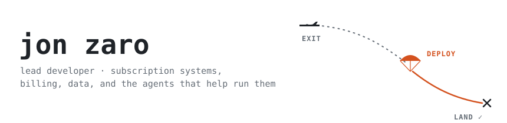
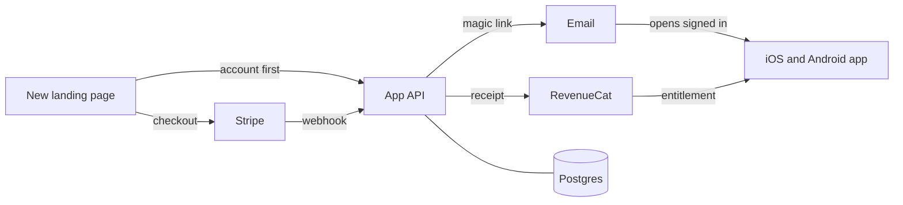

<picture>
  <source media="(prefers-color-scheme: dark)" srcset="assets/header-dark.svg">
  
</picture>

I build the plumbing behind subscription apps: the stretch between *Pay now* and *Welcome in* that nobody thinks about until it breaks. Billing, accounts, data, and lately a crew of AI agents that do the legwork while I make the calls.

Off the clock I jump out of airplanes, which turns out to be decent training for production deploys.

### Right now

Moving a subscription fitness app's web signup off WordPress and onto its own API. Pay on the web, open the app already signed in, no password anywhere.

### How I work

1. **Every cutover ships with a rollback**, and I rehearse it before I need it.
2. **Merged isn't shipped.** It's done when production says so, not when the PR goes green.
3. **Numbers get a second source.** A metric goes on a dashboard after it matches the database.
4. **Agents do the legwork, I make the calls.** Claude runs the searches, the tests and the first drafts. I read every diff.

### Recent work

| When | What | Why it mattered |
|---|---|---|
| Oct 2026 | Passwordless sign-in backend: single-use links and codes, hashed at rest, rate limited | Takes the password step out of paid signup |
| Oct 2026 | Trial reminders moved off WP-cron onto the API | They stop quietly dying when site traffic drops |
| Sep 2026 | Healed 2,403 subscription rows a backfill had left unreachable by webhooks | Billing state matches reality again |

### Stack

`typescript` · `node` · `trpc` · `postgres` + `prisma` · `redis` · `fly.io` · `stripe` · `revenuecat` · `expo` · `astro` · `posthog` · `sentry` · `claude code`

### Contact

[LinkedIn](https://linkedin.com/in/jonzaro) · [Resume](https://jonzaroresume.tiiny.site/) · [Book a call](https://calendly.com/jonzaro) · writetojonzaro@gmail.com

Dad of three boys, which is its own kind of on-call.
